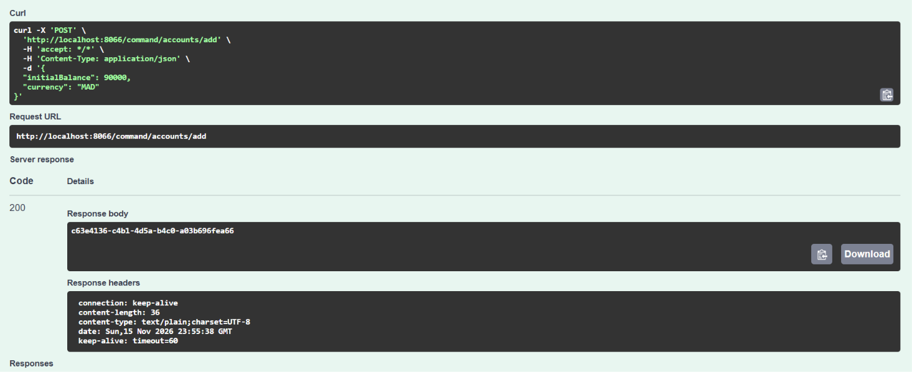
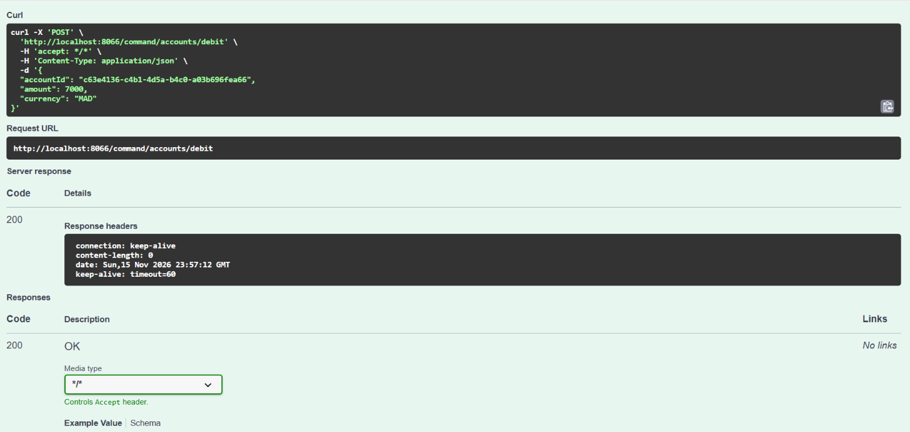
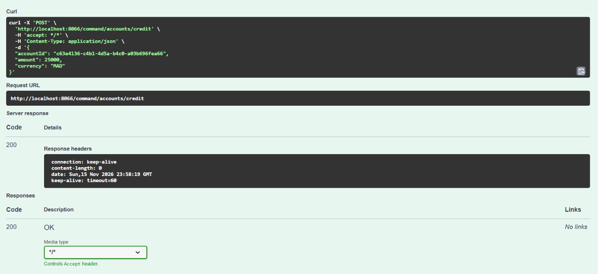
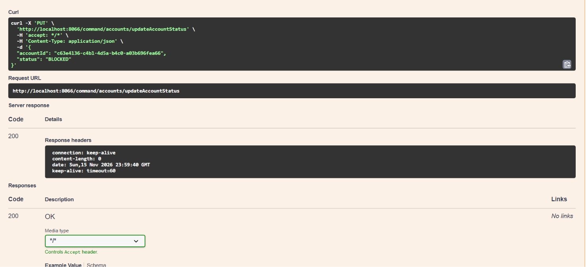
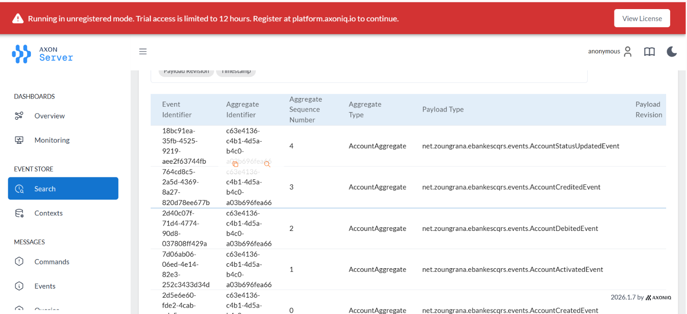
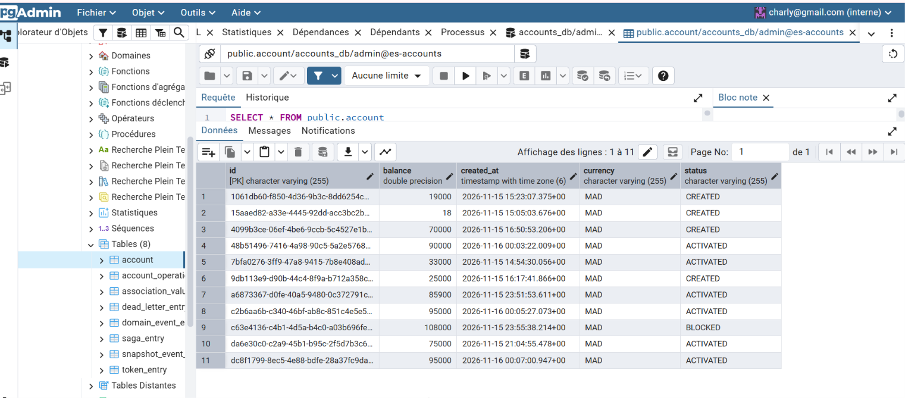
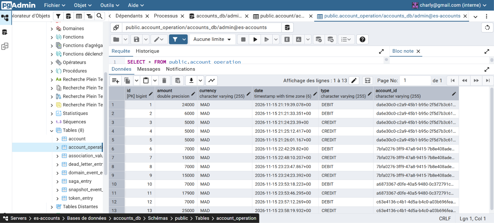

# Gestion de comptes bancaires avec CQRS et Event Sourcing

*Activité pratique n° 4 · Spring Boot, Axon Framework et Axon Server*

Ce TP met en œuvre une API bancaire qui permet d’ouvrir un compte, de l’activer, de le créditer ou le débiter, de modifier son statut et de consulter son relevé. Un abonnement HTTP permet également de recevoir les nouvelles opérations en temps réel.

## Architecture

**CQRS** sépare les demandes de modification des demandes de consultation. Côté commande, l’agrégat vérifie les règles métier avant d’accepter une opération. Côté lecture, les requêtes utilisent des tables préparées pour la consultation. Les deux chemins sont implémentés dans la même application Spring Boot.

**Event Sourcing** conserve les faits métier qui ont modifié un compte. Axon peut reconstruire l’état de l’agrégat en rejouant ces événements dans l’ordre. Par exemple, le solde se retrouve à partir du montant initial, des crédits et des débits. Dans la configuration finale, **Axon Server conserve les événements** et **PostgreSQL contient les projections de lecture** ainsi que les positions de lecture des processeurs Axon.

~~~mermaid
%%{init: {"theme": "neutral"}}%%
flowchart LR
    Client["Client HTTP"]
    CMD["CommandGateway"]
    AGG["AccountAggregate"]
    STORE["Axon Server Journal des événements"]
    PROJ["AccountEventHandler"]
    DB["PostgreSQL Projections de lecture"]
    QRY["QueryGateway AccountQueryHandler"]

    Client -->|Commande REST| CMD
    CMD --> AGG
    AGG -->|Événements métier| STORE
    STORE -->|Relecture de l’historique| AGG
    STORE -->|Flux d’événements| PROJ
    PROJ -->|Mise à jour| DB
    Client -->|Consultation REST| QRY
    QRY -->|Lecture JPA| DB
    PROJ -->|Abonnement SSE via QueryUpdateEmitter| Client
~~~

## Côté commande

Le contrôleur REST transforme la requête en commande et la transmet à `CommandGateway`. Dans `AccountAggregate`, un `@CommandHandler` décide si l’opération est autorisée et appelle `AggregateLifecycle.apply(...)` pour produire l’événement. Les méthodes `@EventSourcingHandler` appliquent les événements à l’état interne du compte, lors de l’opération comme lors d’une relecture.

| Commande | Événement produit | Règle métier |
| --- | --- | --- |
| `AddAccountCommand` | `AccountCreatedEvent`, puis `AccountActivatedEvent` | Le solde initial doit être supérieur ou égal à zéro. L’activation suit la création automatiquement. |
| `DebitAccountCommand` | `AccountDebitedEvent` | Le compte doit être actif et le solde doit couvrir le montant. Un montant négatif est refusé. |
| `CreditAccountCommand` | `AccountCreditedEvent` | Le compte doit être actif. Un montant négatif est refusé. |
| `UpdateAccountStatusCommand` | `AccountStatusUpdatedEvent` | Le statut demandé doit être différent du statut courant et le compte ne peut pas revenir à `CREATED`. |

### Scénario vérifié dans Swagger

Les quatre requêtes ci-dessous concernent le même compte. Le scénario commence à **90 000 MAD**, se poursuit par un débit de **7 000 MAD** et un crédit de **25 000 MAD**, puis se termine par le blocage du compte avec un solde de **108 000 MAD**.

**Ouverture du compte.** Le POST reçoit le solde initial et la devise. Le corps de la réponse HTTP 200 contient l’identifiant du compte, réutilisé dans les requêtes suivantes.

**Débit.** La requête indique l’identifiant du compte, le montant et la devise. Le débit de 7 000 MAD est accepté.

**Crédit.** La requête utilise le même identifiant. L’ajout de 25 000 MAD porte le solde à 108 000 MAD.

**Blocage.** La mise à jour passe le compte au statut `BLOCKED`. Le code métier réserve les crédits et les débits aux comptes au statut `ACTIVATED`.

### Historique dans Axon Server

Le tableau de bord Axon Server affiche les cinq événements de cet agrégat. La colonne du numéro de séquence permet de retrouver l’ordre métier, de `0` à `4` **création → activation → débit → crédit → changement de statut**. Le payload des événements est écrit et relu en JSON via Jackson. Les constructeurs annotés avec `@JsonCreator` et `@JsonProperty` permettent de reconstruire les objets Java à partir du JSON stocké.

## Côté lecture

Le processeur d’événements lit le flux d’Axon Server et appelle les méthodes `@EventHandler` de `AccountEventHandler`. Elles créent ou mettent à jour la ligne du compte et ajoutent une ligne à chaque crédit ou débit. Pour servir une consultation, `QueryGateway` transmet la requête à `AccountQueryHandler`, qui lit ces projections via Spring Data JPA. Le relevé rassemble le compte et ses opérations.

La mise à jour des projections se fait de manière asynchrone. Après un POST réussi, la ligne du compte peut donc apparaître avec un léger délai côté lecture.

**Table `account`.** La ligne du compte utilisé dans Swagger indique le solde projeté de **108 000 MAD** et le statut **BLOCKED**.

**Table `account_operation`.** Les deux dernières lignes de la capture correspondent au débit de **7 000 MAD** et au crédit de **25 000 MAD** pour ce compte. Cette table sert à construire le relevé.

### Suivi en temps réel

Sur `/query/accounts/watch/{accountId}`, le contrôleur ouvre une requête de souscription Axon et renvoie un `Flux<AccountOperation>` au format `text/event-stream`. Après avoir enregistré un crédit ou un débit dans PostgreSQL, le handler émet la nouvelle opération via `QueryUpdateEmitter`. Le client connecté peut ainsi recevoir la mise à jour sans interroger l’API en boucle.

Dans la version actuelle, le prédicat d’émission vaut toujours `true`. Le flux diffuse donc les opérations aux abonnements correspondants sans filtrer par l’identifiant de compte fourni dans l’URL.

## Exécution locale

Le projet utilise **Java 21**, **Spring Boot 4.1.2**, **Axon Framework 4.13.2** et **Springdoc OpenAPI 3.2.0**. Avec Docker Desktop démarré, lance les services puis l’application depuis la racine du projet.

~~~powershell
docker compose up -d
docker compose ps
.\mvnw.cmd spring-boot:run
~~~

| Service | Accès local |
| --- | --- |
| Swagger UI | [localhost:8066/swagger-ui/index.html](http://localhost:8066/swagger-ui/index.html) |
| Tableau de bord Axon Server | [localhost:8024](http://localhost:8024) |
| Axon Server gRPC | `localhost:8124` |
| PostgreSQL | `localhost:5432`, base `accounts_db` |
| pgAdmin | [localhost:8088](http://localhost:8088) |

### Endpoints

| Méthode | Route | Usage |
| --- | --- | --- |
| POST | `/command/accounts/add` | Ouvrir un compte et récupérer son identifiant. |
| POST | `/command/accounts/credit` | Créditer un compte actif. |
| POST | `/command/accounts/debit` | Débiter un compte actif. |
| PUT | `/command/accounts/updateAccountStatus` | Modifier le statut. |
| GET | `/command/accounts/events/{accountId}` | Consulter les événements de l’agrégat dans l’Event Store. |
| GET | `/query/accounts/all` | Lister les comptes projetés. |
| GET | `/query/accounts/accountStatement/{accountId}` | Consulter le compte et ses opérations. |
| GET | `/query/accounts/watch/{accountId}` | Ouvrir le flux SSE des nouvelles opérations. |

### Passage de PostgreSQL à Axon Server

Avant l’intégration d’Axon Server, le journal d’événements du TP était stocké dans PostgreSQL. Après le changement de source, le processeur de lecture récupérait encore dans `token_entry` un `GapAwareTrackingToken` propre à l’ancien journal. Axon Server attendait un `GlobalSequenceTrackingToken` et le processeur redémarrait en boucle avant d’atteindre les handlers.

La reprise a consisté à arrêter l’application, à retirer uniquement le token du processeur `net.zoungrana.ebankescqrs.query.handlers`, puis à redémarrer. Axon a recréé une position compatible avec son flux. Cette opération permet de relire les événements présents dans Axon Server. Les événements restés dans l’ancien journal PostgreSQL nécessitent une migration pour faire partie de ce flux. [Guide de migration Axon Server](https://docs.axoniq.io/axon-server-reference/v2026.0/axon-server/migration/non-axon-server-to-axon-server/)

## Supports du TP

[Présentation de CQRS et de l’Event Sourcing](https://www.youtube.com/watch?v=AVpyvoJI4Cc) · [Démonstration pratique de Mohamed Youssfi](https://www.youtube.com/watch?v=ZxE9mbvu0og)
